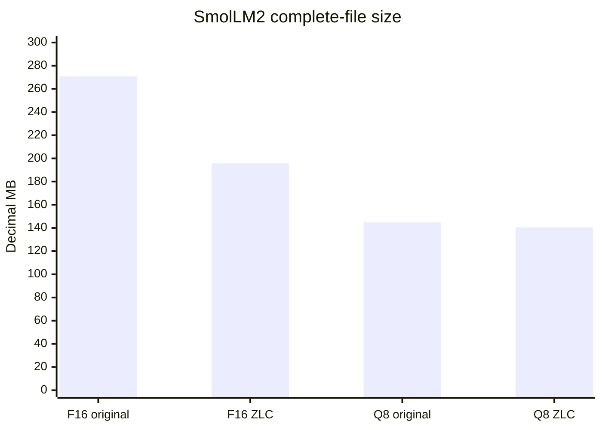
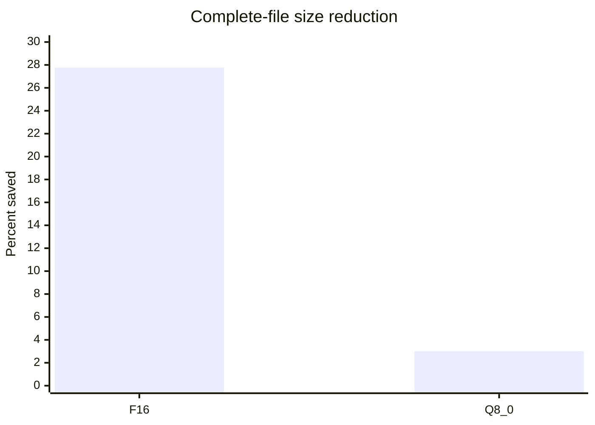
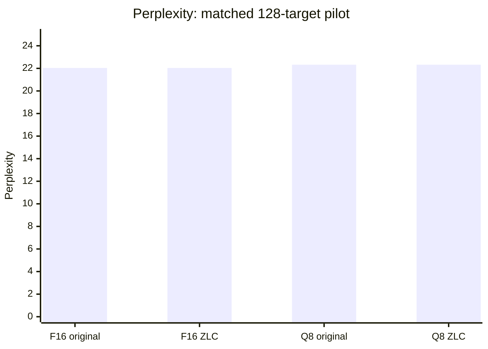
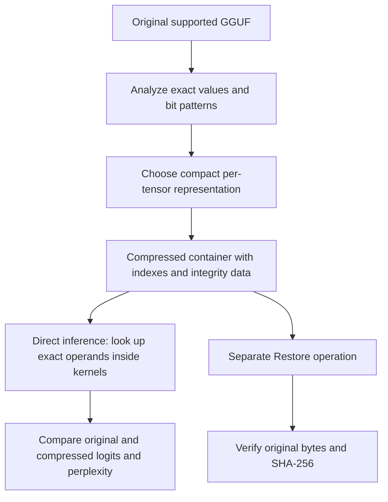
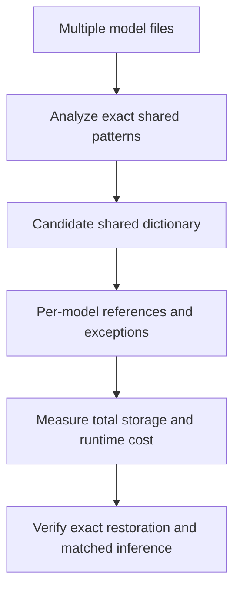

# Nexus ZLC · Zero Loss Compression

## Created with AI-assisted coding

**Rich Dunbar · Nexus Emerging Technology · Build → Measure → Learn**

I developed Nexus ZLC using **AI-assisted coding**, directing the project and using AI to help implement, debug, review and refine the code. Development followed a repeated **build–measure–learn** cycle: turn an idea into an experiment, inspect the evidence and use the result to guide the next revision.

### Where the idea began

The original goal was to compress a small office assistant embedded within a **custom, Power BI-like HTML dashboard**. I had integrated a small language model to help users understand and work with that dashboard, and wanted a compact file that could reconstruct itself when opened.

A saved early self-extracting HTML audit records:

| Early HTML artifact | Size |
| --- | ---: |
| Original input HTML | **4,663,015 bytes** |
| Compressed self-extracting HTML | **2,699,012 bytes** |
| Reduction relative to the original input | **42.12%** |
| Corrected expanded application reconstructed at launch | **4,682,576 bytes** |

The compressed package reconstructs the corrected expanded application, whose size differs from the original input because the packaging work included repairs. The documented **42.118736%** reduction is measured against the original input, and replaces my approximate recollection of 50%. I recall the file reconstructing in about a second on my test bed, but a reproducible timing record has not been established for that figure.

This early HTML approach reconstructed the complete application before initialization. The later GGUF compressed-inference work follows a different execution path.

### From repeated patterns to compressed model execution

The idea was inspired by pattern recognition. When I inspected GGUF files, I noticed repeated patterns, blocks and sequences in the data. I wanted to replace suitable repeated values or structures with compact references and store the information needed to recover their meaning exactly.

GGUF contains **model metadata and numerical tensor data**, rather than executable source code. In the implemented codecs, the “placeholders” are indexes, packed fields and other compact representations that the Nexus runtime knows how to decode.

After verifying that a compressed file could restore exactly, I extended my custom **web-based WebGPU inference engine** to work with supported compressed representations.

My objective was to avoid expanding the complete weight matrix before inference. Instead, the kernels look up or reconstruct the exact numerical operands they need while computing. This still involves decoding; the distinction is **local operand reconstruction without a fully expanded weight-matrix allocation**.

### Original contribution and research context

**To my knowledge, the specific Nexus ZLC implementation and integration described here are an original contribution arising from my own development work.**

That is a statement about this project and its implementation, not a claim that I invented dictionary compression, lossless model compression or compressed-weight inference. Those fields have substantial prior work, acknowledged below. Establishing research novelty for a particular mechanism requires comparison with that work.

---

### Lossless GGUF compression and experimental compressed-weight inference

**Developed by Rich Dunbar · Nexus Emerging Technology**

Nexus ZLC is an experimental offline toolkit that reduces supported GGUF model files while preserving their original data exactly. Its custom WebGPU backend reads supported compressed weights directly, reconstructing the operands it needs inside its kernels without allocating a fully expanded weight matrix.

The suite combines compression, exact restoration, integrity verification, and before-and-after perplexity evaluation.

> **Research status — October 9, 2026:** The tested SmolLM2-135M-Instruct files achieved **27.76% complete-file reduction for F16** and **3.01% for Q8_0**. Original and compressed inference produced identical logits in a **128-target native software-adapter pilot**. These are not full-corpus or physical-GPU performance results.

## Why Nexus ZLC?

Offline AI deployment is often constrained by model storage and memory capacity. Nexus ZLC explores reducing those requirements without introducing another quantization step.

The intended use case is preserving the supplied model representation while fitting more of its weights into limited memory. A smaller representation could help avoid CPU offload, but that capacity and performance benefit still requires testing on the target hardware.

## Evidence summary

| Claim | What the available record supports |
|---|---|
| Early dashboard/application compression | A saved self-extracting HTML audit records **42.12%** reduction |
| Approximately one-second HTML reconstruction | Developer recollection; reproducible timing not verified |
| Original F16 reconstruction | Recorded exact-restoration checks; source size and SHA-256 identify the expected original |
| Direct compressed inference | Implemented kernel-local operand lookup/reconstruction without a full expanded weight matrix in the tested path |
| F16 and Q8 perplexity preservation | **Both paired 128-target pilots completed with identical logits and scores** |
| Physical test-bed use | Developer reports running the program on his test bed |
| Radeon throughput and total physical VRAM savings | Not established by the saved software-adapter paired benchmarks |
| General capability preservation across tasks | Not established by a 128-target pilot alone |
| Data-center deployment and shared cross-model dictionaries | Future research directions |

The reported model file sizes below replace approximate figures such as “around 26%.” Test-bed observations, recorded numerical results and proposed applications are kept distinct.

## Features

- Lossless compression of supported F16 and Q8_0 GGUF files.
- Exact full-file restoration, including metadata and padding.
- Source hashes and integrity checks.
- Direct compressed-weight evaluation for admitted SmolLM2 model pairs.
- Before-and-after perplexity testing through the shared Nexus backend.
- Offline HTML interface with no remote inference service.
- No PyTorch or llama.cpp runtime dependency in the browser application.

## Compression results

Complete-file measurements include dictionaries, indexes, exceptions, headers, metadata, alignment, padding, and integrity information.

| Representation | Original bytes | Compressed bytes | Bytes saved | Reduction |
|---|---:|---:|---:|---:|
| F16 → F16TRI1 | 270,885,952 | 195,676,989 | 75,208,963 | **27.764069%** |
| Q8_0 → NHDMOD1 | 144,811,360 | 140,446,944 | 4,364,416 | **3.013863%** |

### Original versus compressed file size



### Percentage reduction



**Units:** 1 MB = 1,000,000 bytes.

**Calculation:** Reduction = 100 × (1 − compressed bytes / original bytes).

### Why F16 compressed better in this experiment

The tested F16 checkpoint contains repeated values and structured bit fields that can be represented compactly. Q8_0 already stores quantized bytes and scales, leaving less redundancy for this codec to exploit.

These results concern one checkpoint family. They do not establish a universal compression ratio for F16 or Q8 models. The compressed F16 file also remains larger than the original Q8 file.

## Before-and-after perplexity

| Input | Original perplexity | Direct compressed perplexity | Unequal logits / total |
|---|---:|---:|---:|
| F16 | 22.035450548743963 | 22.035450548743963 | **0 / 6,291,456** |
| Q8_0 | 22.32640069870509 | 22.32640069870509 | **0 / 6,291,456** |



Within each representation:

- Every compared logit was bit-identical.
- Maximum absolute logit difference was zero.
- Every per-target negative log-likelihood matched.
- Perplexity was unchanged.

**Important:** These are 128-target WikiText-2 test-prefix measurements with context 128. They are not full WikiText-2 benchmark scores. Compare before and after within each row; F16 and Q8 already have different numerical representations before ZLC compression.

## What “zero loss” means

### Exact source-file preservation

Restore reproduces the complete original GGUF bytes and SHA-256, including metadata and padding. The restored file must match the source representation, not merely produce similar model output.

Saved reference-restoration records identify matching original and restored files:

```text
F16 original AND restored — 270,885,952 bytes
SHA-256: f535f83ec568d040f88ddc04a199fa6da90923bbb41d4dcaed02caa924d6ef57

Q8_0 original AND restored — 144,811,360 bytes
SHA-256: 5a1395716f7913741cc51d98581b9b1228d80987a9f7d3664106742eb06bba83
```

Both saved records report **exact byte equality** and **full SHA-256 verification**. They are reference-restoration records, explicitly marked as not performed during the paired inference run. This documentation update did not rerun those operations.

| Reference restoration | Verified bytes | Exact byte equality | Original/restored SHA-256 |
|---|---:|---|---|
| F16 | 270,885,952 | **True** | **Matching** |
| Q8_0 | 144,811,360 | **True** | **Matching** |

### Input-relative losslessness

Compressing Q8 preserves the supplied Q8 data. It does not recover information lost during the original quantization to Q8. Compressing F16 preserves the supplied F16 data.

### Tested inference equivalence

The original and compressed paths produced identical logits in the recorded pilot. This does not guarantee portable bitwise inference across every device or backend, because floating-point arithmetic and reduction order can differ.

## How it works

GGUF stores model data. The application supplies fixed code that understands the compressed representation. Model files do not supply executable code.



### F16TRI1

The baseline chooses among representations according to complete serialized cost:

- Literal 16-bit words.
- Constant-bit packing.
- Exact scalar dictionaries and fixed-width indexes.
- Frequent-word dictionaries with exact exceptions.
- Exponent-window packing with exact exception information.

The tested matrices used 147 frequent-word packets and 64 exponent-window packets. Small normalization tensors retain their original inference precision.

### NHDMOD1 for Q8_0

The Q8 path preserves original FP16 scales and signed quantized bytes. It uses exact scale dictionaries where beneficial. For eligible 32-value blocks, a ±127 anchor can be represented by its position and sign rather than a stored byte. Other cases use literal fallback.

### Direct compressed-weight inference

Compressed packets remain resident. WGSL matrix-vector and embedding kernels reconstruct requested numerical operands locally.

This still requires lookup and decoding work. The benefit being investigated is avoiding a fully expanded weight-matrix buffer. Activations, KV state, scratch buffers, and ancillary tensors continue to require memory.

Full-file Restore is a separate export and verification operation, not the direct-inference path.

## Evaluation protocol

**Model:** HuggingFaceTB SmolLM2-135M-Instruct, using bartowski's F16 and Q8_0 GGUF artifacts.

**GGUF revision:** `b57b6475ae6f5f2b1b51c43a1190a64cab325ef4`

**Dataset:** WikiText-2 raw test, Salesforce revision `b08601e04326c79dfdd32d625aee71d232d685c3`.

**Coverage:** 128 next-token targets. Input positions 0–127 predict targets 1–128 exactly once.

**Tokenizer:** Embedded GPT-2 BPE/SmolLM tokenizer, with no added BOS/EOS, chat template, or special-token parsing.

**Runtime:** Native wgpu with SwiftShader CPU-Vulkan. This is a software adapter, not a physical Radeon GPU benchmark.

**Arithmetic:** F32 activations and accumulation, packed F16 KV, matched reduction strategy, and cleared state for each paired run.

**Scoring:** Independent float64 stabilized log-sum-exp; perplexity is the exponential of token-weighted mean natural-log negative log-likelihood. No sampling or logit processing is applied.

**Independent total NLL:**

- F16: 395.85952576563494.
- Q8_0: 397.53854285539813.

The dataset was held out from this compression experiment. Its absence from the original model's pretraining is not established. Shared inference defects could affect both paths equally, so paired agreement does not independently certify the entire engine.

## Memory measurements

| Representation | Original explicit buffers | Compressed explicit buffers |
|---|---:|---:|
| F16 | 272,295,456 B | 197,087,772 B |
| Q8_0 | 146,220,592 B | 141,786,712 B |

Each pair additionally shares 196,608 readback bytes.

These are instrumented application-owned buffer totals. They exclude host memory, backend staging, and driver/internal allocations. They are **not measured physical VRAM usage**. The paired comparison process holds both inference paths.

### Physical test-bed observations

I have run this program on my own test bed. That hands-on use is part of the project's development history.

The exact before/after perplexity and buffer figures in this README come from the recorded **SwiftShader CPU-Vulkan** experiments. They must not be presented as measured Radeon throughput, peak physical VRAM or data-center efficiency results. A physical-device report needs the matching model/build hashes, browser, driver, GPU, workload and measurement method.

## Quick start

1. Open the released `Nexus-ZLC.html`.
2. Select a supported original GGUF.
3. Compress and verify exact Restore.
4. Save the compressed file and retain the original reference.
5. For an admitted model pair, run the before-and-after evaluator.
6. Record model hashes, evaluation text, target count, context, runtime, and results.

If WebGPU is unavailable from a local file origin, serve the release folder on localhost:

```bash
python -m http.server 8000 --bind 127.0.0.1
```

Then open `http://localhost:8000/Nexus-ZLC.html`. Do not bypass browser security warnings.

The codec supports bounded little-endian GGUF v2/v3 files, with a maximum 512 MiB original model and supported F16/Q8_0 layouts. Inference support is narrower: the exact admitted SmolLM2 pairs and validated filename-only aliases. This release does not establish arbitrary GGUF or Mistral 14B compatibility.

## Academic context

Lossless model compression and compressed neural-network execution have substantial prior art. Nexus ZLC is an experimental GGUF-oriented implementation with matched F16/Q8_0 evidence. My originality statement concerns the specific Nexus implementation; no claim of being first in the field or outperforming the following systems is made.

| Research | Relevance |
|---|---|
| CER/CSER | Compact low-entropy matrices and computation using shared numerical values. |
| ZipNN | Lossless compression of neural-network data for storage and transfer. |
| DFloat11 | Lossless floating-point compression with GPU decompression and block-level inference integration. |
| ZipServ | Hardware-aware lossless compression, including fused decode-stage decompression and matrix computation without a dense intermediate global-memory buffer. |

These references provide research context. Their results are not Nexus ZLC results, and citation does not imply their code is bundled.

Nexus ZLC is separate from the project's LittleBit-inspired lossy factorization and recovery-training work. The tested ZLC codec introduces no additional quantization and requires no recovery training.

### References

1. Wiedemann, S., Müller, K.-R., & Samek, W. (2018). *Compact and computationally efficient representation of deep neural networks*. arXiv. https://arxiv.org/abs/1805.10692

2. Hershcovitch, M., Wood, A., Choshen, L., Girmonsky, G., Leibovitz, R., Ennmouri, I., Malka, M., Chin, P., Sundararaman, S., & Harnik, D. (2024). *ZipNN: Lossless compression for AI models* (Version 2, revised 2025). arXiv. https://arxiv.org/abs/2411.05239v2

3. Zhang, T., Hariri, M., Zhong, S., Chaudhary, V., Sui, Y., Hu, X., & Shrivastava, A. (2025). *70% size, 100% accuracy: Lossless LLM compression for efficient GPU inference via dynamic-length float (DFloat11)*. NeurIPS. Cited arXiv version 3, January 2026: https://arxiv.org/abs/2504.11651v3

4. Fan, R., Yu, X., Pan, X., Li, Z., Luo, W., Wang, Q., Wang, W., & Chu, X. (2026). *ZipServ: Fast and memory-efficient LLM inference with hardware-aware lossless compression*. ASPLOS. https://doi.org/10.1145/3779212.3790250

5. Ben Allal, L., et al. (2025). *SmolLM2: When Smol goes big—Data-centric training of a small language model*. arXiv. https://arxiv.org/abs/2502.02737

6. Merity, S., Xiong, C., Bradbury, J., & Socher, R. (2016). *Pointer sentinel mixture models*. arXiv. https://arxiv.org/abs/1609.07843

### Models and engineering references

- [HuggingFaceTB SmolLM2-135M-Instruct](https://huggingface.co/HuggingFaceTB/SmolLM2-135M-Instruct)
- [Evaluated bartowski GGUF revision](https://huggingface.co/bartowski/SmolLM2-135M-Instruct-GGUF/tree/b57b6475ae6f5f2b1b51c43a1190a64cab325ef4)
- [GGUF specification](https://github.com/ggml-org/ggml/blob/master/docs/gguf.md)
- [WebGPU Shading Language](https://www.w3.org/TR/WGSL/)
- [Pinned llama.cpp QA/tokenization reference](https://github.com/ggml-org/llama.cpp/tree/b42b7e6d3059503dd4bed6ca5dcf342bb6379f67)

llama.cpp was used for reference tooling and tokenization checks. The browser application's inference backend is the Nexus implementation.

## Future research: shared pattern libraries

I want to investigate **exact patterns shared across multiple language models**. A pattern that appears only once in one model may still be reusable if the same bytes or numerical representation occur in other models.

The proposed idea is a versioned shared dictionary, with each participating model storing compact references and its own exceptions. This is **not implemented or validated by the baseline experiments described here**.



A fair comparison must include:

- The complete shared dictionary and versioning information.
- Every model's references, indexes, metadata and exceptions.
- Total storage across the collection, compared with compressing each model independently.
- Dictionary residency, cache behavior and temporary allocations during inference.
- Exact restoration and output comparisons for each admitted model.
- Models held out from dictionary construction.

Similar weight distributions are not enough: lossless reuse requires exact reconstructability.

## Potential relevance to larger deployments

The F16 result demonstrates **27.764069% lower complete-file storage for the tested checkpoint without changing its stored F16 values**. The paired pilot also demonstrates matching inference outputs for the tested inputs.

If those properties generalize with acceptable runtime overhead, this approach could help memory-constrained local systems and larger deployments preserve a higher-precision representation while storing more model data in a limited budget.

However, **27.76% smaller files do not automatically mean 27.76% lower total VRAM, faster inference or unchanged quality on every task**. Activations, KV cache, temporary buffers, dictionary access and hardware behavior also matter.

Quantization trades precision for compactness; lossless encoding pursues a different trade-off involving redundancy and decoding cost. Existing lossless systems already explore this field. Nexus ZLC's potential data-center value requires its own multi-model, physical-hardware evidence.

## Limitations and next steps

- One checkpoint family and two supplied numerical representations.
- Short-prefix evaluation rather than full-corpus perplexity.
- Developer-reported test-bed use, but no quantified browser/Radeon throughput or physical-VRAM benefit established by the saved paired runs.
- No universal compression ratio, portable bitwise result, or production-readiness claim.
- Experimental enhanced F16 formats are excluded from the reported paired baseline results.

Next steps are longer held-out evaluations, independent graph validation, additional models, and controlled physical-GPU measurements of peak memory, prefill, first-token latency, and decode speed. The enhanced F16 variant previously reaching approximately **28.73%** reduction still needs its own paired full-graph perplexity evaluation; its compression result must not be combined with the baseline's inference evidence.

## Credits and licensing

Credit HuggingFaceTB for SmolLM2, bartowski for the evaluated GGUF distributions, the WikiText authors and maintainers, the ggml/llama.cpp contributors, and the cited research teams.

This README does not grant or alter software, model, dataset, or third-party licenses. The inspected app package declares `UNLICENSED` and has no LICENSE file; an explicit software license should be added before offering reuse permissions. Retain all applicable third-party licenses and notices.

---

**Nexus Emerging Technology · Experimental offline AI research**
